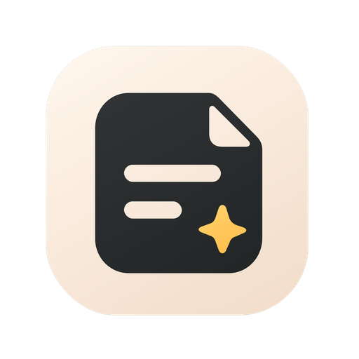
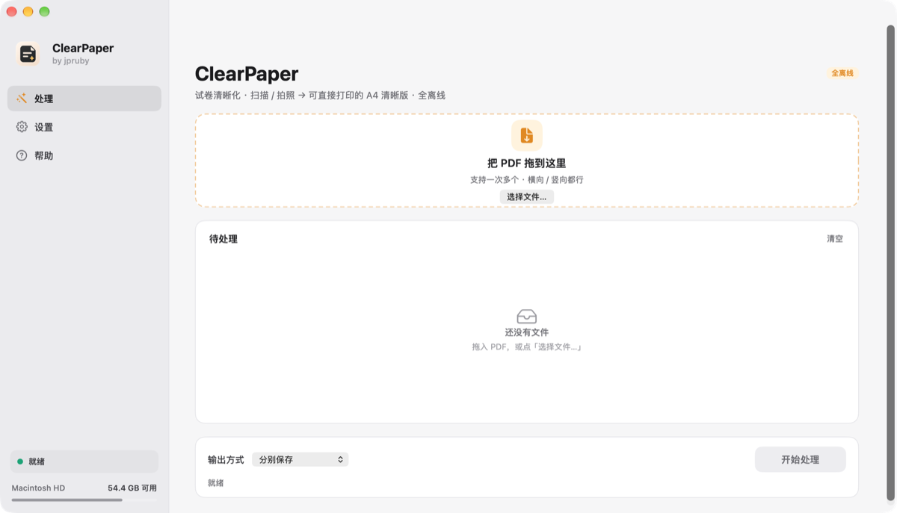
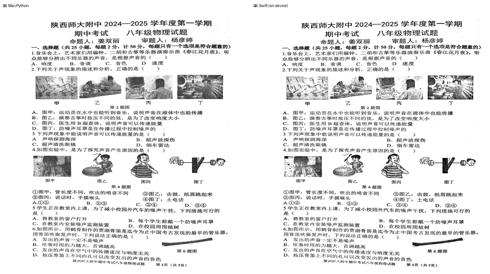
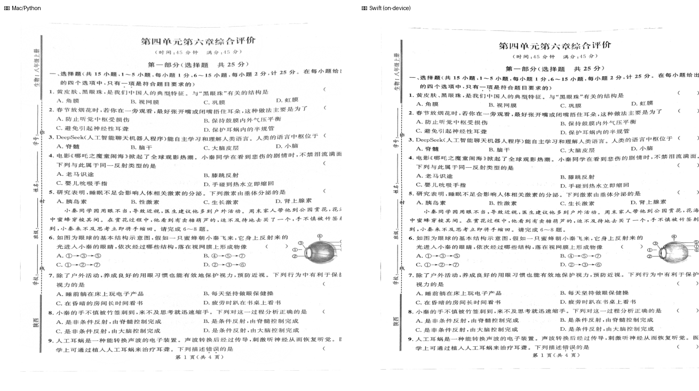
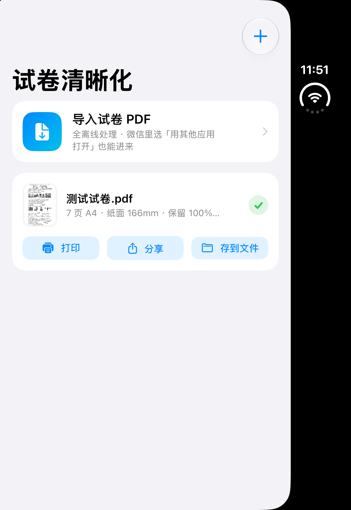

<p align="right"><a href="README_EN.md">English</a> · 中文</p>

<p align="center">
  
</p>

<h1 align="center">ClearPaper</h1>

<p align="center">
  <b>把模糊、发黑、带扫描边框的试卷 PDF，一键变成能直接打印的清晰 A4 版。</b><br>
  原生 macOS + iOS 双端 App，<b>全离线、零依赖、不联网、无服务端</b>。
</p>

<p align="center">
  
  
  
  
</p>

---

## ✨ 为什么要做这个

老师发来的扫描件 / 手机拍照 PDF，经常有这些毛病：

- 页面尺寸离谱（28×41 英寸），打印被缩到 25%；
- 四周一圈扫描黑框、纸边卷影；
- iPhone 备忘录导出的「白画布」，浪费了 25% 幅面；
- 照片和文字混排，文字发灰、笔画断断续续；
- 原始分辨率低，放大就糊。

**ClearPaper 就是专门收拾这些的。** 它自动判断问题、分区域处理，输出标准的 **210×297mm A4 清晰版**，并且带着一道「质量闸门」——任何真实笔画都不许被抹掉。

> 实测：物理卷 7 页 A4，笔画保留 **100%**；生物卷 8 页 A4，纸面 190mm，保留 **100%**。

## 📸 效果

<p align="center">
  
  <br><sub>ClearPaper：侧边栏 + 卡片式布局，处理 / 设置 / 帮助</sub>
</p>

同一页试卷，左边是参考用的 Python 引擎、右边是编译进 App 的 Swift 端上引擎——**两者输出一致**，说明手机/电脑里跑的就是同一套算法：

<p align="center">
  
  <br><sub>物理卷：Python 引擎（左） vs Swift 端上引擎（右）</sub>
</p>

<p align="center">
  
  <br><sub>生物卷：Python 引擎（左） vs Swift 端上引擎（右）</sub>
</p>

iPhone 上的处理结果卡片（全离线，导入 PDF → 本机处理 → 打印 / 分享 / 存到文件）：

<p align="center">
  
</p>

## 🚀 快速开始（不用编译）

### macOS · 拖进应用程序即可用

1. 到 [Releases](https://github.com/jpruby0127/ClearPaper/releases) 下载 **`ClearPaper-macOS-1.4.0.dmg`**；
2. 打开 DMG，把「试卷清晰化」拖进「应用程序」；
3. 首次打开若被拦截：右键 App → 「打开」→「打开」。

App 自带清晰化引擎，**朋友电脑不需要 Python、venv 或任何配置**。把 PDF 拖进窗口（或拖到 Dock 图标，可一次多个）即可。输出默认在 `文稿/试卷清晰版`，可在「文件 › 选择输出文件夹…」改到任意位置并记住。

> **新增：多份合并。** 把多份 PDF 按添加顺序合并成一个完整 PDF，可选「完全合并」或「合并（间隔·双面）」——后者会在每份文档后补空白页，双面打印时不同试卷不会落在同一张纸上。列表可直接拖动调整顺序。
>
> **已修复：横向 PDF。** 横向排版的页面会输出横向 A4（297×210mm），竖横混排逐页匹配方向，不再被裁掉。

### iPhone / iPad · 自签一次，永久可用

1. 到 [Releases](https://github.com/jpruby0127/ClearPaper/releases) 下载 **`ClearPaper-iOS-1.4.0-unsigned.ipa`**；
2. 电脑装 [Sideloadly](https://sideloadly.io/)（或 AltStore），连上 iPhone，选这个 IPA，填你的 Apple ID 自签；
3. 手机：「设置 → 通用 → VPN 与设备管理」信任该开发者；
4. 微信里收到试卷 →「用其他应用打开」→ 选「试卷清晰化」；或在 App 内点「导入试卷 PDF」。

> 个人免费账号签名 **7 天**有效，到期重签一次即可；文件都在手机本机，不会丢。

### Windows · 解压即用（免安装）

1. 到 [Releases](https://github.com/jpruby0127/ClearPaper/releases) 下载 **`ScanClean-Windows-portable.zip`**；
2. 解压整个 `ScanClean` 文件夹（别只拖出单个文件）；
3. 把试卷 PDF 拖到 `ScanClean.bat` 上（可一次多个），结果出现在原文件旁：`<原名>-清晰版.pdf`。

内置 Python 与全部依赖，**不写注册表、不联网、删文件夹即卸载**；首次运行若被 SmartScreen 拦，点「更多信息 → 仍要运行」。支持 Win10 / Win11 64 位。

## 🧠 它自动判断并处理了什么

| 检测到的毛病 | 处理方式 |
|---|---|
| MediaBox 尺寸离谱（如 28×41 英寸） | 重建为标准 A4，打印不再被缩到 25% |
| 四周扫描黑框 / 纸边卷影 | 连通域 + 边缘条带剔除，只删贴边伪影，不动填空下划线 |
| iPhone 备忘录白画布 | 裁回纸面，找回被浪费的 25% 幅面 |
| 照片与文字混排 | 分区处理：文字强加深，照片保留层次 |
| 原始分辨率偏低 | 整卷统一比例放置，DPI 不足 230 时重采样到 ~300 |
| 横向排版的页面 | 输出横向 A4（297×210mm）；竖横混排逐页匹配方向，不再裁切 |

gamma 不是写死的：从小到大试，直到「原图真实笔画在输出里确实黑」（笔画亮度中位 ≤105）。

### 质量闸门（每次输出都跑）

- 四个阈值下逐页比对，**任何真实墨迹都不许被裁掉**；
- **笔画保留率 ≥97%**（连通域级，只认成片的笔画，不被 JPEG 噪点骗）；
- 页面必须是 **210×297 mm**；
- 页数与原件一致。

踩过的两个坑都已解决：平场校正由加法改为**乘法白点归一化**（淡笔画不再被推成纯白）；非锐化掩模改为**只加深不提亮**的单向锐化（笔画丢失从 7.9% 降到 0–1%）。

## 🛠 从源码构建

仓库克隆后，两端都能在本机直接编译，**无需任何第三方依赖**（Swift 标准库 + 系统框架即可）。

```bash
git clone https://github.com/jpruby0127/ClearPaper.git
cd ClearPaper
```

### macOS App

```bash
cd macos
./build_app.sh                 # 非沙盒 + 强化运行时，装到 ~/Applications/试卷清晰化.app
# SANDBOX=1 ./build_app.sh     # 上架版：开启 App Sandbox
# SIGN_ID="你的证书" ./build_app.sh   # 指定签名身份
```

### iOS App（未签名 IPA，供自签）

```bash
cd ios
./build_ios.sh ../ClearPaper-iOS-unsigned.ipa
```

跑模拟器看效果：

```bash
./build_sim.sh shot.png        # 构建、安装、启动模拟器，并可截图
```

> 需要 Xcode 命令行工具与 iOS SDK（`xcode-select --install`）。图标已随仓库提交，构建不依赖 Python。

## 🐍 Python 参考引擎（可选）

macOS / iOS App 走的是**编译进包的 Swift 引擎**（可分发、零依赖）。`python/` 里是同一套算法的**参考实现**，方便你研究、批处理或在服务器上跑：

```bash
cd python
pip install pymupdf numpy pillow scipy
./bin/scanpdf 某试卷.pdf          # 输出 <名字>-清晰版.pdf
./bin/scanpdf --check            # 自检
```

## 🗺 路线图

- [ ] 多页拼接 / 双面试卷自动合并
- [ ] 自定义输出纸张（B5 / Letter）与 DPI
- [ ] 批量文件夹监视（桌面端常驻）
- [ ] 更多语言的 OCR 文字层（保留原图、可选叠加）
- [ ] Windows / Linux 命令行版

欢迎提 Issue 和 PR，一起把它打磨成真正的「开源神器」。

## 📦 发布说明

| 版本 | 平台 | 产物 | 说明 |
|---|---|---|---|
| v1.4.0 | macOS | `ClearPaper-macOS-1.4.0.dmg` | 新 Logo + 品牌更名 ClearPaper；侧边栏 UI |
| v1.4.0 | iOS | `ClearPaper-iOS-1.4.0-unsigned.ipa` | 新 Logo；原生 App，全离线，需自签安装 |
| v1.0.1 | Windows | `ScanClean-Windows-portable.zip` | 免安装便携包，内置 Python 与依赖，拖拽即用 |

> 当前分发用的是本机 **Apple Development** 证书：Mac DMG 在本人/同账号下双击即开；发给他人建议用 **Developer ID** 重签并 `notarytool` 公证（命令已就绪，无需改代码）。iOS 个人账号签名 7 天有效。

## 📄 许可证

[MIT](LICENSE) — 随便用、随便改、随便上架，留个名就行。

---

<p align="center">
  用 Swift 写的离线试卷清晰化工具 · 数据不出本机 · 打开即印
</p>
