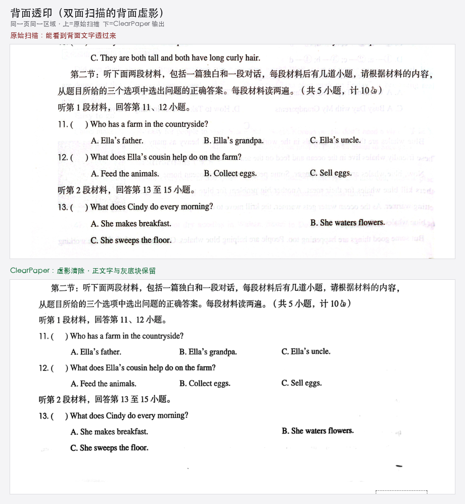
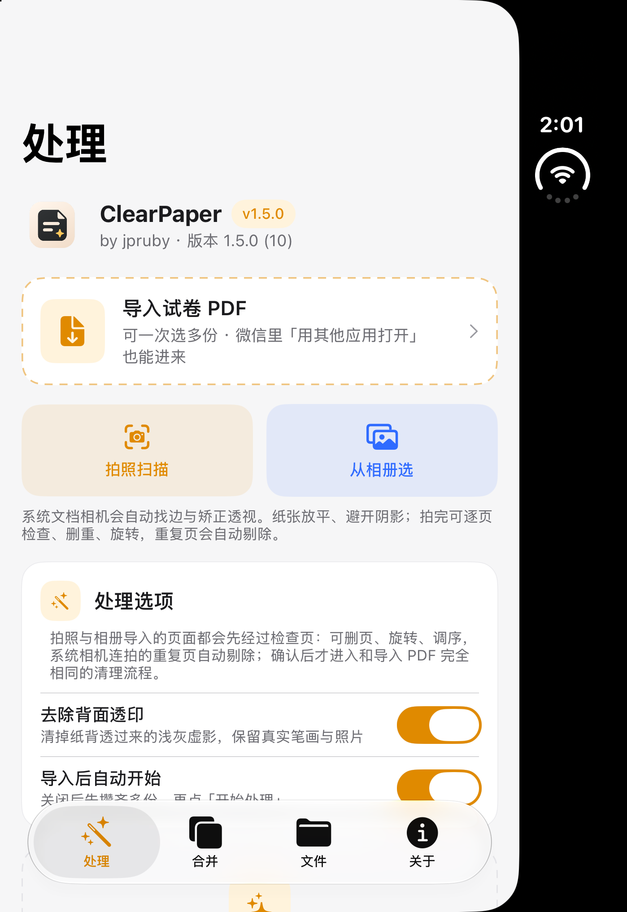
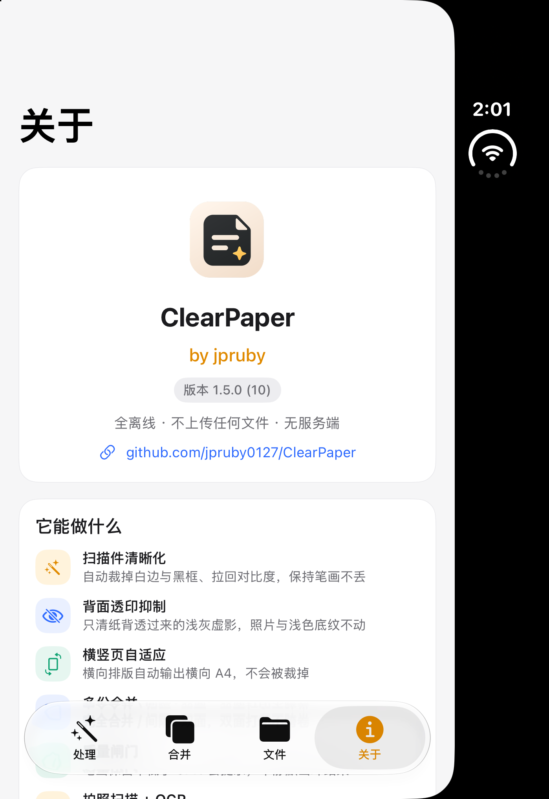
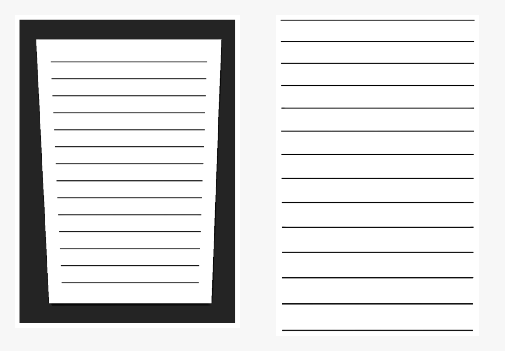
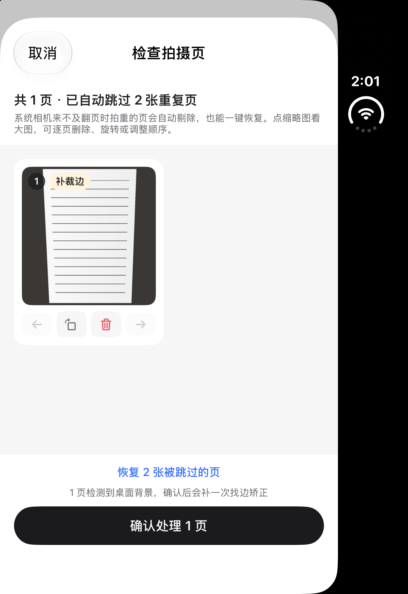

<p align="right"><a href="README_EN.md">English</a> · 中文</p>

<p align="center">
  
</p>

<h1 align="center">ClearPaper</h1>

<p align="center">
  <b>把模糊、发黑、带扫描边框的试卷 PDF，一键变成能直接打印的清晰 A4 版。</b><br>
  原生 macOS / iOS App + Windows 免安装版，<b>全离线、零依赖、不联网、无服务端</b>。
</p>

<p align="center">
  
  
  
  
  
</p>

---

## ✨ 为什么要做这个

老师发来的扫描件 / 手机拍照 PDF，经常有这些毛病：

- 页面尺寸离谱（28×41 英寸），打印被缩到 25%；
- 四周一圈扫描黑框、纸边卷影；
- iPhone 备忘录导出的「白画布」，浪费了 25% 幅面；
- 照片和文字混排，文字发灰、笔画断断续续；
- 原始分辨率低，放大就糊。

**ClearPaper 就是专门收拾这些的。** 它自动判断问题、分区域处理，输出标准的 **210×297mm A4 清晰版**，并且带着一道「质量闸门」——任何真实笔画都不许被抹掉。

> 实测：物理卷 7 页 A4，笔画保留 **100%**；生物卷 8 页 A4，纸面 190mm，保留 **100%**。

## 📸 效果

<p align="center">
  
  <br><sub>ClearPaper：侧边栏 + 卡片式布局，处理 / 设置 / 帮助</sub>
</p>

同一页试卷，左边是参考用的 Python 引擎、右边是编译进 App 的 Swift 端上引擎——**两者输出一致**，说明手机/电脑里跑的就是同一套算法：

<p align="center">
  
  <br><sub>物理卷：Python 引擎（左） vs Swift 端上引擎（右）</sub>
</p>

<p align="center">
  
  <br><sub>生物卷：Python 引擎（左） vs Swift 端上引擎（右）</sub>
</p>

纸张背面透印（双面卷最常见）：浅灰虚影会被清掉，真实笔画和灰色底纹一律不动。

<p align="center">
  
  <br><sub>同一页同一区域：上=处理前（可见背面文字虚影），下=处理后</sub>
</p>

iOS 端是四页式界面（全离线，导入 / 拍照 → 本机处理 → 合并 / 打印 / 分享 / 存到文件）：

<p align="center">
  
  
  <br><sub>左：处理页（拍照扫描、去透印开关、任务卡片）　右：关于页（by jpruby · 版本 1.5.0 (10)）</sub>
</p>

## 🚀 快速开始（不用编译）

### macOS · 拖进应用程序即可用

1. 到 [Releases](https://github.com/jpruby0127/ClearPaper/releases) 下载 **`ClearPaper-macOS-1.5.0.dmg`**；
2. 打开 DMG，把 **ClearPaper** 拖进「应用程序」；
3. 首次打开若被拦截：右键 App → 「打开」→「打开」。

App 自带清晰化引擎，**朋友电脑不需要 Python、venv 或任何配置**。把 PDF 拖进窗口（或拖到 Dock 图标，可一次多个）即可。输出默认在 `文稿/试卷清晰版`，可在「文件 › 选择输出文件夹…」改到任意位置并记住。

> **新增：多份合并。** 把多份 PDF 按添加顺序合并成一个完整 PDF，可选「完全合并」或「合并（间隔·双面）」——后者会在每份文档后补空白页，双面打印时不同试卷不会落在同一张纸上。列表可直接拖动调整顺序。
>
> **已修复：横向 PDF。** 横向排版的页面会输出横向 A4（297×210mm），竖横混排逐页匹配方向，不再被裁掉。
>
> **新增：背面透印抑制。** 双面扫描最常见的「背面文字透过来」虚影会被单独识别并抹回纸白；判断依据是「浅灰 + 远离真实笔画 + 不成片」，所以灰底横幅、表格底纹、照片都不会被误删。

### iPhone / iPad · 自签一次，永久可用

1. 到 [Releases](https://github.com/jpruby0127/ClearPaper/releases) 下载 **`ClearPaper-iOS-1.5.0-unsigned.ipa`**；
2. 电脑装 [Sideloadly](https://sideloadly.io/)（或 AltStore），连上 iPhone，选这个 IPA，填你的 Apple ID 自签；
3. 手机：「设置 → 通用 → VPN 与设备管理」信任该开发者；
4. 微信里收到试卷 →「用其他应用打开」→ 选 **ClearPaper**；或在 App 内点「导入试卷 PDF」。

> 个人免费账号签名 **7 天**有效，到期重签一次即可；文件都在手机本机，不会丢。

**iOS 端现在有什么（1.5.0 / build 10）**

- 四个标签页：**处理 / 合并 / 文件 / 关于**，暖灰配色跟随系统深浅色（也能手动锁定）；
- **关于**页有 Logo、**by jpruby**、从 `Info.plist` 读取的真实版本号与构建号、开源地址；
- **处理**页：导入 PDF、系统文档相机拍照扫描、相册多选；去透印与「导入后自动开始」开关；任务卡片显示页数 / 纸面宽度 / 笔画保留率 / 透印处理状态 / 耗时 / 拍照件的找边矫正与完整流程，可预览、打印、分享、存到文件、重试、删除；
- **合并**页：完全合并 / 间隔·双面（每份后补空白页，双面打印不跨卷）/ 分别保存，顺序可上下调整，与 macOS 端共用 `engine/Merge.swift`；
- **文件**页：输出 PDF 与 OCR 文字稿统一列出，按时间排序，可预览、打印、分享、复制、加入合并、删除；
- **拍照扫描 + 检查拍摄页 + OCR**：见下一节。

### Windows · 解压即用（免安装）

1. 到 [Releases](https://github.com/jpruby0127/ClearPaper/releases) 下载 **`ClearPaper-Windows-portable.zip`**；
2. 解压整个 `ClearPaper` 文件夹（别只拖出单个文件）；
3. 把试卷 PDF 拖到 `ClearPaper.bat` 上（可一次多个），结果出现在原文件旁：`<原名>-清晰版.pdf`。

内置 Python 与全部依赖，**不写注册表、不联网、删文件夹即卸载**；首次运行若被 SmartScreen 拦，点「更多信息 → 仍要运行」。支持 Win10 / Win11 64 位。

## 🧠 它自动判断并处理了什么

| 检测到的毛病 | 处理方式 |
|---|---|
| MediaBox 尺寸离谱（如 28×41 英寸） | 重建为标准 A4，打印不再被缩到 25% |
| 四周扫描黑框 / 纸边卷影 | 连通域 + 边缘条带剔除，只删贴边伪影，不动填空下划线 |
| iPhone 备忘录白画布 | 裁回纸面，找回被浪费的 25% 幅面 |
| 照片与文字混排 | 分区处理：文字强加深，照片保留层次 |
| 原始分辨率偏低 | 整卷统一比例放置，DPI 不足 230 时重采样到 ~300 |
| 横向排版的页面 | 输出横向 A4（297×210mm）；竖横混排逐页匹配方向，不再裁切 |
| 纸张背面透印（浅灰虚影） | 只清除「远离真实笔画、不成片」的浅灰，纸白归位；灰底块与照片保留 |

gamma 不是写死的：从小到大试，直到「原图真实笔画在输出里确实黑」（笔画亮度中位 ≤105）。

### 质量闸门（每次输出都跑）

- 四个阈值下逐页比对，**任何真实墨迹都不许被裁掉**；
- **笔画保留率 ≥97%**（连通域级，只认成片的笔画，不被 JPEG 噪点骗）；
- 页面必须是 **210×297 mm**；
- 页数与原件一致。

踩过的两个坑都已解决：平场校正由加法改为**乘法白点归一化**（淡笔画不再被推成纯白）；非锐化掩模改为**只加深不提亮**的单向锐化（笔画丢失从 7.9% 降到 0–1%）。

## 📷 拍照扫描 + OCR：检查完再整理

<p align="center">
  
  <br><sub>同一张带桌面背景的歪斜试卷：左＝原帧直接进引擎的旧结果，右＝补上找边矫正后</sub>
  <br><br>
  
  <br><sub>拍完先检查：逐页缩略图、删页 / 旋转 / 调序、重复页自动剔除与一键恢复，「补裁边」标出裁边失败的页</sub>
</p>

iOS 端除了导入 PDF，还能直接拍，而且拍完先过一遍检查页：

1. **只用系统文档相机**（`VisionKit / VNDocumentCameraViewController`）：多页拍摄时自动找边、透视矫正、画质增强，成像质量是最好的一档。原先那套自研「翻页自动拍」相机裁边不准，已彻底移除；系统的自动快门苹果不给外部关闭，所以重复页改在下一步解决。
2. **拍完先检查，再处理**：新增「检查拍摄页」——逐页缩略图可点开看大图、删除、旋转 90°、调整顺序；来不及翻页造成的重复页按 64 位 dHash + 灰度均差自动剔除（相邻宽松 / 非相邻严格，避免误删版式相近的不同页），并且**能一键恢复**，绝不静默丢页。原图逐页落在 Application Support，检查页只持有缩略图，多拍几页也不会爆内存。
3. **按需补一道找边矫正**：相册照片是带桌面、阴影、歪斜的原帧，逐页走 `VNDetectDocumentSegmentationRequest` + `CIPerspectiveCorrection`（Vision 找不到边时退到 Otsu + 拟合纸边的几何兜底）；系统相机偶尔裁边失败、仍带背景的页也会被逐页检测出来、标上「补裁边」，只对这些页补裁。已经裁好的纸面图原样保留，绝不做二次裁剪。这一步很关键——直接把带背景的原帧喂给扫描引擎，平场归一化会把桌面当成纸白、裁边会把整帧当内容，出来的就是瑕疵品。
4. **完整清理流程**：矫正后的页合成 PDF，走**和导入 PDF 完全相同**的 ScanCore —— 乘法白点归一化 → 背面透印抑制 → 自适应 gamma → 单向锐化 → 裁边 → 横竖 A4 → 笔画保留率闸门，不通过会明确报错，不静默出坏结果。
5. **本机 OCR**：系统 `Vision` 识别中英文（离线、零额外体积），导出 `<标题>-文字.txt`，并用首页最像标题的一行自动给文件命名。文字稿可查看、全选复制、分享，在「文件」页与 PDF 一起管理。

> PDF 本身仍是图像，不叠加文字层，避免破坏打印效果与笔画质量闸门。
> 拍摄原稿逐页落到 Application Support，App 被系统挂起、临时目录被清理后仍可重试重建。

### 进阶：小米开源的 Xiaomi-OCR-0

[Xiaomi-OCR-0](https://github.com/xiaomi-research/Xiaomi-OCR-0)（0.8B，Apache 2.0，2026-10-30 开源）能把整页解析成**结构化 Markdown**（表格 OTSL、公式 LaTeX），还能做字段抽取（JSON）与文档问答。`python/ocr_xiaomi.py` 是它的轻量桥接后端，按官方 `DOC_PROMPT` 和请求格式调用**本机**的 OpenAI 兼容服务：

```bash
# 先起服务（任选其一，权重约 1.8–2GB，需要 GPU 或较快的 CPU）
vllm serve SeerRay-Lab/Xiaomi-OCR-0 --host 127.0.0.1 --port 8000 --max-model-len 16384

cd python
python ocr_xiaomi.py 某试卷.pdf                 # → 某试卷-OCR.md
python ocr_xiaomi.py 表格.png --task kie --fields "姓名,学号,总分"
```

服务地址只接受 `127.0.0.1 / localhost`，**不会把文档发到外网**；环境变量 `XIAOMI_OCR_LOCAL_URL` / `XIAOMI_OCR_MODEL` 与官方 Demo 同名。Ollama（社区 BF16 GGUF）或 SGLang 也能直接用。

**为什么模型不塞进 IPA**：0.8B 的 Qwen3.5 多模态权重约 1.8GB，需要 Core ML / GGUF 转换与专有推理运行时；塞进去会让现在 450KB 的 IPA 膨胀几千倍，还会拖慢启动与处理。所以 iPhone 上用系统 Vision 做「即开即用」的文字识别，Xiaomi-OCR-0 留给桌面 / 服务器做结构化整理，两者产物（`.txt` / `.md`）都能在「文件」页查看。追求最佳解析质量时，用小米官方的 Demo / MCP 服务（含版面分析与后处理）。

## 🛠 从源码构建

仓库克隆后，两端都能在本机直接编译，**无需任何第三方依赖**（Swift 标准库 + 系统框架即可）。

```bash
git clone https://github.com/jpruby0127/ClearPaper.git
cd ClearPaper
```

### macOS App

```bash
cd macos
./build_app.sh                 # 非沙盒 + 强化运行时，装到 ~/Applications/ClearPaper.app
# SANDBOX=1 ./build_app.sh     # 上架版：开启 App Sandbox
# SIGN_ID="你的证书" ./build_app.sh   # 指定签名身份
```

### iOS App（未签名 IPA，供自签）

```bash
cd ios
./build_ios.sh ../ClearPaper-iOS-unsigned.ipa
```

跑模拟器看效果：

```bash
./build_sim.sh shot.png        # 构建、安装、启动模拟器，并可截图
```

> 需要 Xcode 命令行工具与 iOS SDK（`xcode-select --install`）。图标与 `ios/Logo.png` 已随仓库提交；`Core.swift`（引擎）、`Merge.swift`（合并）、`Capture.swift`（文档相机 + 找边矫正 + OCR）、`ScanReview.swift`（检查拍摄页）都是源码直编，只链接系统框架，不依赖 Python 或任何第三方库。

## 🐍 Python 参考引擎（可选）

macOS / iOS App 走的是**编译进包的 Swift 引擎**（可分发、零依赖）。`python/` 里是同一套算法的**参考实现**，方便你研究、批处理或在服务器上跑：

```bash
cd python
pip install pymupdf numpy pillow scipy
./bin/scanpdf 某试卷.pdf          # 输出 <名字>-清晰版.pdf
./bin/scanpdf --check            # 自检
# 可选：接本机 Xiaomi-OCR-0 做结构化 Markdown（见「拍照 + OCR」一节）
python ocr_xiaomi.py 某试卷.pdf   # 输出 <名字>-OCR.md
```

## 🗺 路线图

- [x] 多页拼接 / 双面试卷自动合并（macOS 1.3 / iOS 1.5）
- [x] 拍照扫描 + 检查拍摄页 + OCR 文字稿（iOS 1.5 · 系统文档相机 / 重复页剔除与恢复 / 按需找边矫正 / 可选 Xiaomi-OCR-0）
- [ ] 自定义输出纸张（B5 / Letter）与 DPI
- [ ] 批量文件夹监视（桌面端常驻）
- [ ] 可搜索 PDF 文字层（目前导出 `.txt` 旁文件，不改动打印用 PDF）
- [x] Windows 免安装版（v1.1.0）
- [ ] Linux 命令行版

欢迎提 Issue 和 PR，一起把它打磨成真正的「开源神器」。

## 📦 发布说明

| 版本 | 平台 | 产物 | 说明 |
|---|---|---|---|
| v1.5.0 | macOS | `ClearPaper-macOS-1.5.0.dmg` | 新 Logo + 品牌更名 ClearPaper；侧边栏 UI |
| v1.5.0 | iOS | `ClearPaper-iOS-1.5.0-unsigned.ipa` | build 10：只用系统文档相机，新增拍完「检查拍摄页」（删页 / 旋转 / 调序 / 重复页剔除与一键恢复）、裁边失败页自动标记并补矫正、图像方向与尺寸归一；彻底移除实验性自研相机；拍照件仍强制走完整 ScanCore 清理流程；四页 UI、by jpruby 与真实版本信息、本机 OCR 文字稿、多份合并、文件管理、外观设置；可选 Xiaomi-OCR-0 后端 |
| v1.2.0 | Windows | `ClearPaper-Windows-portable.zip` | 品牌更名 ClearPaper；免安装便携包，拖拽即用 |

> 当前分发用的是本机 **Apple Development** 证书：Mac DMG 在本人/同账号下双击即开；发给他人建议用 **Developer ID** 重签并 `notarytool` 公证（命令已就绪，无需改代码）。iOS 个人账号签名 7 天有效。

## 📄 许可证

[MIT](LICENSE) — 随便用、随便改、随便上架，留个名就行。

---

<p align="center">
  ClearPaper · by jpruby · 用 Swift / Python 写的离线试卷清晰工具<br>
  数据不出本机 · 打开即印
</p>
