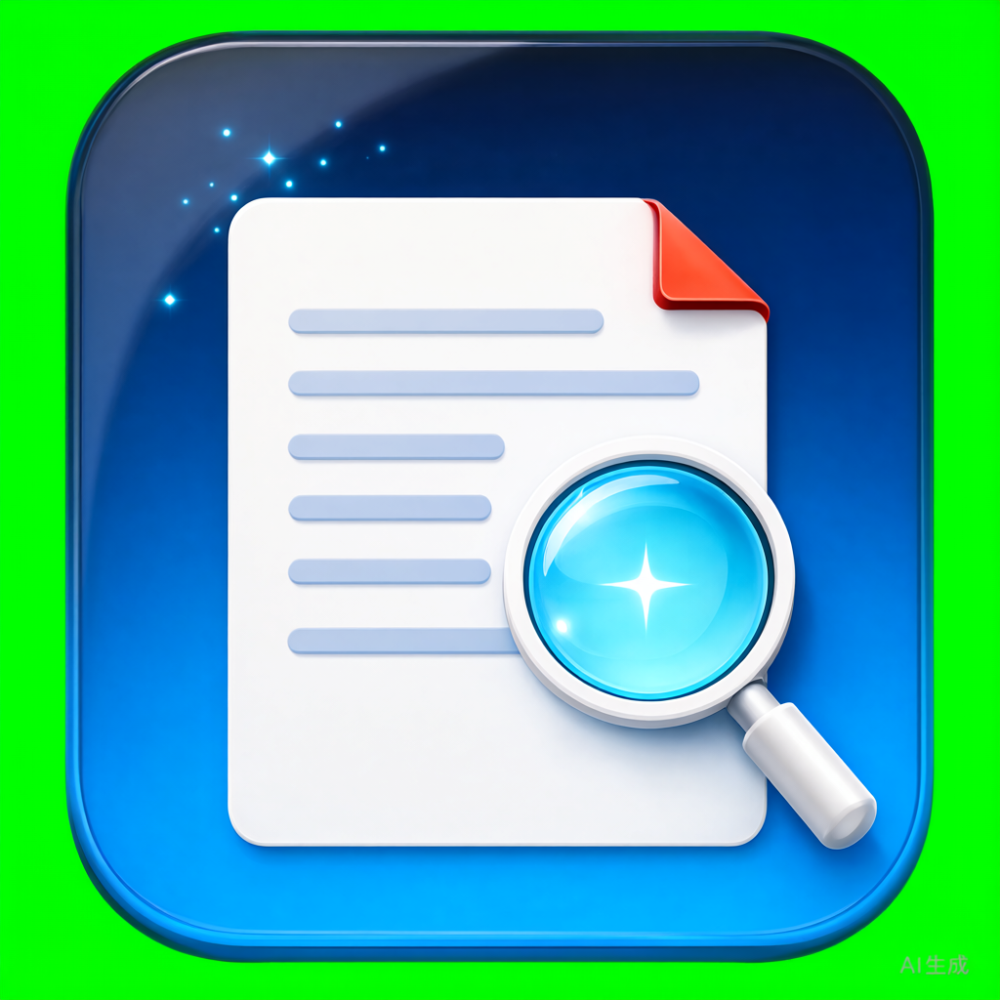
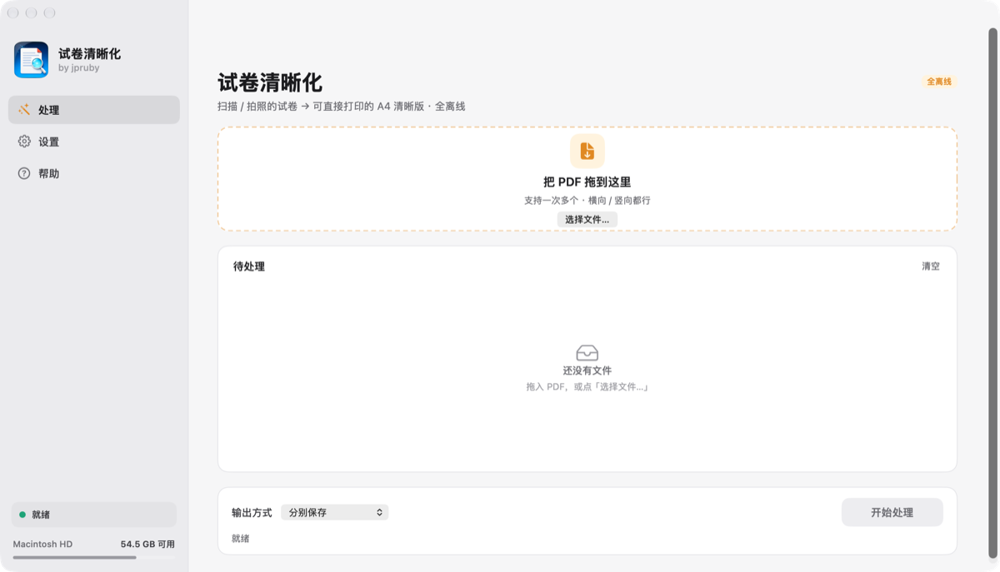
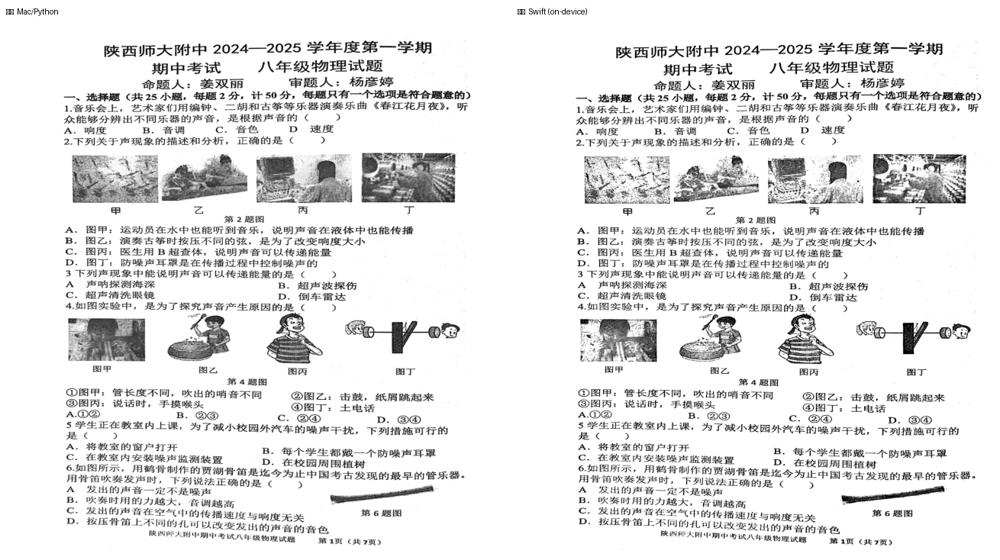
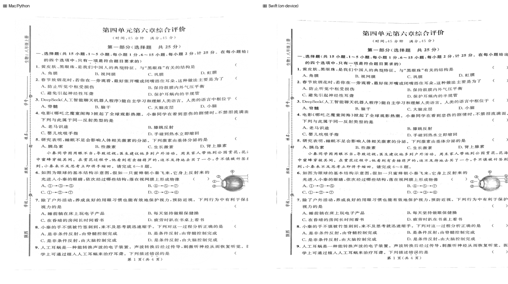
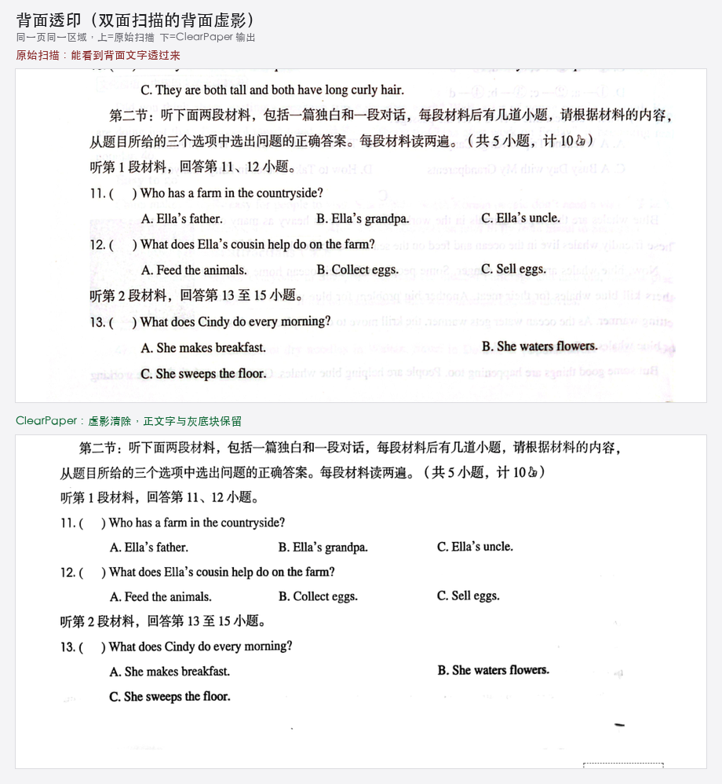
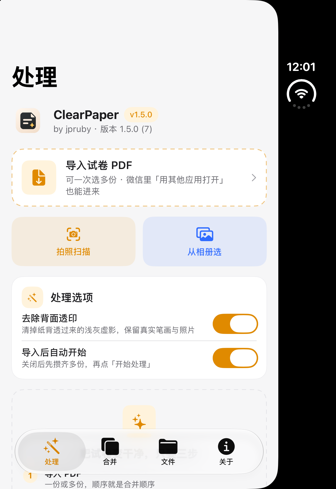
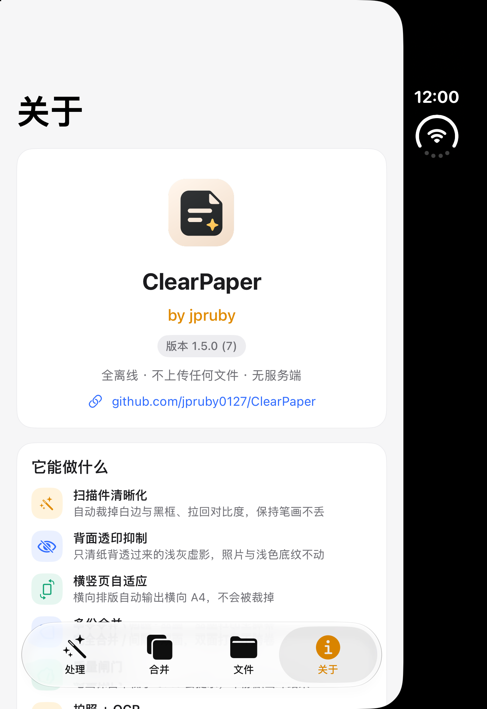

<p align="right"><a href="README.md">中文</a> · English</p>

<p align="center">
  
</p>

<h1 align="center">ClearPaper</h1>

<p align="center">
  <b>Turn blurry, dark, scan-framed exam-PDFs into print-ready, crisp A4 — in one step.</b><br>
  Native macOS / iOS apps plus a Windows portable build. <b>100% on-device, zero dependencies, no network, no server.</b>
</p>

<p align="center">
  
  
  
  
  
</p>

---

## ✨ Why this exists

Scans and phone photos of exam papers usually come with problems:

- Page size is absurd (e.g. 28×41 in) → prints get shrunk to 25%
- Black scan borders / page-curl shadows around the edges
- iPhone Notes "white canvas" wasting ~25% of the page
- Photos mixed with text → grey, broken strokes
- Low native resolution → blurry when scaled

**ClearPaper fixes all of that.** It detects the problem, processes per-region, and outputs a standard **210×297 mm A4** PDF — guarded by a **quality gate** that refuses to drop any real ink.

> Verified: physics paper 7 A4 pages, **100%** stroke retention; biology paper 8 A4 pages, 190 mm sheet width, **100%** retention.

## 📸 Results

<p align="center">
  
  <br><sub>ClearPaper: sidebar + card layout for Process / Settings / Help</sub>
</p>

Same page: reference Python engine (left) vs the Swift on-device engine compiled into the app — **identical output**, proving the phone/desktop runs the same algorithm:

<p align="center">
  
  <br><sub>Physics: Python engine (left) vs Swift on-device engine (right)</sub>
</p>

<p align="center">
  
  <br><sub>Biology: Python engine (left) vs Swift on-device engine (right)</sub>
</p>

Show-through from the back of the sheet (the most common double-sided scan artifact) is lifted back to paper white, while real ink, grey banners and photos stay untouched.

<p align="center">
  
  <br><sub>Same page, same area: top = before (ghost text visible), bottom = after</sub>
</p>

The iOS app has four tabs (fully on-device: import / scan → process → merge / print / share / save):

<p align="center">
  
  
  <br><sub>Left: process tab (scan, show-through toggle, job cards) · Right: about tab (by jpruby · v1.5.0 (7))</sub>
</p>

## 🚀 Quick start (no build)

### macOS · drag into Applications

1. Download **`ClearPaper-macOS-1.5.0.dmg`** from [Releases](https://github.com/jpruby0127/ClearPaper/releases);
2. Open the DMG and drag **ClearPaper** into Applications;
3. If blocked on first launch: right-click the app → Open → Open.

The app bundles its own engine — **no Python, venv, or config needed** on the friend's Mac. Drop a PDF onto the window (or the Dock icon, multiple at once). Output defaults to `Documents/试卷清晰版`; change it via **File › 选择输出文件夹…**.

> **New: show-through removal.** Faint mirror text bleeding through from the back of the sheet is detected and lifted to paper white. The rule is "light + isolated from real strokes + not a solid block", so grey banners, table shading and photos survive.
>
> **New: multi-file merge.** Merge several PDFs into one in the order you added them — either **full** (straight concatenation) or **duplex-safe** (a blank page after each document so two papers never share a sheet when printing double-sided). Drag rows to reorder.

### iPhone / iPad · self-sign once, keep forever

1. Download **`ClearPaper-iOS-1.5.0-unsigned.ipa`** from [Releases](https://github.com/jpruby0127/ClearPaper/releases);
2. On your computer install [Sideloadly](https://sideloadly.io/) (or AltStore), connect the iPhone, pick this IPA, sign with your Apple ID;
3. On the phone: Settings → General → VPN & Device Management → trust the developer;
4. In WeChat, open a paper → "Open in another app" → choose **ClearPaper**; or tap "导入试卷 PDF" in the app.

> Free personal signatures last **7 days**; re-sign once when expired. Files stay on the device.

**What's in the iOS app (1.5.0 / build 7)**

- Four tabs: **Process / Merge / Files / About**, warm-grey palette that follows (or can override) the system appearance.
- **About**: logo, **by jpruby**, real version + build read from `Info.plist`, repo link.
- **Process**: import PDFs, scan with the camera, pick from the photo library; show-through and auto-start toggles; job cards with pages / sheet width / stroke retention / show-through / elapsed time, plus preview, print, share, save, retry and delete.
- **Merge**: full / duplex-safe (blank page after each document) / keep separate, reorderable, sharing `engine/Merge.swift` with macOS.
- **Files**: output PDFs and OCR transcripts in one list — preview, print, share, copy, add to merge, delete.
- **Scan + OCR**: see the section below.

### Windows · portable, no install

1. Download **`ClearPaper-Windows-portable.zip`** from [Releases](https://github.com/jpruby0127/ClearPaper/releases);
2. Extract the whole `ClearPaper` folder (not just a single file);
3. Drag PDFs onto `ClearPaper.bat` (several at once); results land next to each source as `<name>-清晰版.pdf`.

Python and all dependencies are bundled — **no registry, no network, delete the folder to uninstall**. If SmartScreen blocks the first run, click "More info → Run anyway". Windows 10/11 64-bit.

## 🧠 What it detects & fixes

| Detected issue | Fix |
|---|---|
| Absurd MediaBox (e.g. 28×41 in) | Rebuild to standard A4 (no more 25% shrink) |
| Scan borders / edge shadows | Connected-component + edge-strip removal (keeps underline blanks) |
| iPhone Notes white canvas | Crop back to paper, recover wasted 25% |
| Photo + text mixed | Per-region: deepen text, keep photo tones |
| Low resolution | Uniform placement per batch; resample to ~300 DPI if below 230 |
| Landscape pages | Output A4 landscape (297×210 mm); mixed portrait/landscape matched per page, no clipping |
| Bleed-through / show-through | Removes light, isolated ghost pixels; paper returns to white, grey blocks and photos kept |

Gamma is not hard-coded: it steps up until real strokes are genuinely black (stroke-brightness median ≤105).

### Quality gate (runs on every output)

- Compare at four thresholds — **no real ink may be clipped**
- **Stroke retention ≥97%** (connected-component level, not fooled by JPEG noise)
- Page must be **210×297 mm**
- Page count matches the source

Two hard-won fixes are already in: flat-field correction switched from additive to **multiplicative white-point normalization** (faint strokes no longer pushed to white); unsharp mask replaced by **darken-only sharpening** (stroke loss dropped from 7.9% to 0–1%).

## 📷 Scan + OCR: shoot, then organize

On iOS you can also capture pages directly:

1. **Document camera** (`VisionKit`): multi-page shooting with automatic edge detection and perspective correction; or pick several photos at once.
2. **Same cleanup pipeline**: photos are composed into a PDF, then passed through the very same ScanCore (crop / de-ghost / portrait-or-landscape A4 / quality gate) as imported PDFs.
3. **On-device OCR**: system `Vision` recognizes Chinese and English offline with zero extra payload, exports `<title>-文字.txt`, and **auto-names the output** from the most title-like line on page 1. The transcript can be viewed, selected, copied and shared in the app.

> The PDF itself stays image-only — no text layer is overlaid, so print quality and the stroke-retention gate are untouched.

### Advanced: Xiaomi's open-source Xiaomi-OCR-0

[Xiaomi-OCR-0](https://github.com/xiaomi-research/Xiaomi-OCR-0) (0.8B, Apache 2.0, released 2026-10-30) parses a whole page into **structured Markdown** (OTSL tables, LaTeX formulas), extracts fields as JSON and answers questions about a document. `python/ocr_xiaomi.py` is a lightweight bridge that calls a **local** OpenAI-compatible server using the official `DOC_PROMPT` and request shape:

```bash
vllm serve SeerRay-Lab/Xiaomi-OCR-0 --host 127.0.0.1 --port 8000 --max-model-len 16384

cd python
python ocr_xiaomi.py some-paper.pdf                  # → some-paper-OCR.md
python ocr_xiaomi.py form.png --task kie --fields "name,id,total"
```

Only `127.0.0.1 / localhost` is accepted — **documents never leave the machine**. `XIAOMI_OCR_LOCAL_URL` / `XIAOMI_OCR_MODEL` match the official demo. SGLang and the community Ollama BF16 GGUF work too.

**Why the model isn't bundled into the IPA**: 0.8B Qwen3.5 multimodal weights are ~1.8 GB and need a Core ML / GGUF conversion plus a dedicated runtime — that would inflate the 450 KB IPA by three orders of magnitude and slow down launch. So iPhone uses system Vision for instant offline recognition, while Xiaomi-OCR-0 handles structured parsing on desktop / server. Both outputs (`.txt` / `.md`) are viewable in the Files tab. For best parsing quality, use Xiaomi's official Demo / MCP service (layout analysis + post-processing included).

## 🛠 Build from source

Clone and build either app — **no third-party dependencies** (Swift stdlib + system frameworks only).

```bash
git clone https://github.com/jpruby0127/ClearPaper.git
cd ClearPaper
```

### macOS app

```bash
cd macos
./build_app.sh                 # non-sandbox + hardened runtime → ~/Applications/ClearPaper.app
# SANDBOX=1 ./build_app.sh     # App Store sandbox build
# SIGN_ID="Your Cert" ./build_app.sh
```

### iOS app (unsigned IPA for self-signing)

```bash
cd ios
./build_ios.sh ../ClearPaper-iOS-unsigned.ipa
```

Run it in the simulator:

```bash
./build_sim.sh shot.png        # build, install, launch, optional screenshot
```

> Needs Xcode command-line tools + iOS SDK (`xcode-select --install`). Icons and `ios/Logo.png` are committed; `Core.swift` (engine), `Merge.swift` (merge) and `Capture.swift` (scan + OCR) compile straight from source against system frameworks only — no Python, no third-party libraries.

## 🐍 Python reference engine (optional)

The macOS/iOS apps use the **compiled-in Swift engine** (distributable, zero-dep). `python/` holds the **same algorithm as a reference implementation** for study, batch jobs, or servers:

```bash
cd python
pip install -r requirements.txt
./bin/scanpdf some-paper.pdf     # outputs <name>-清晰版.pdf
./bin/scanpdf --check
# optional: structured Markdown via a local Xiaomi-OCR-0 server (see above)
python ocr_xiaomi.py some-paper.pdf
```

## 🗺 Roadmap

- [x] Multi-page stitching / duplex paper merge (macOS 1.3 / iOS 1.5)
- [x] Document scanning + OCR transcript (iOS 1.5 · system Vision / optional Xiaomi-OCR-0)
- [ ] Custom output paper (B5 / Letter) and DPI
- [ ] Desktop folder-watch daemon
- [ ] Searchable PDF text layer (currently a sibling `.txt`, print PDF untouched)
- [x] Windows portable build (v1.1.0)
- [ ] Linux CLI build

Issues and PRs welcome — let's make this a real open-source gem together.

## 📦 Releases

| Version | Platform | Artifact | Notes |
|---|---|---|---|
| v1.5.0 | macOS | `ClearPaper-macOS-1.5.0.dmg` | New logo + ClearPaper rebrand; sidebar UI |
| v1.5.0 | iOS | `ClearPaper-iOS-1.5.0-unsigned.ipa` | build 7: four-tab UI (Process / Merge / Files / About), `by jpruby` + real version, document scanning + on-device OCR transcript, multi-file merge, file manager, appearance setting; optional Xiaomi-OCR-0 backend |
| v1.2.0 | Windows | `ClearPaper-Windows-portable.zip` | ClearPaper rebrand; portable, bundled deps, drag-and-drop |

> Current distribution uses a local **Apple Development** certificate: the Mac DMG opens on the same account; for others, re-sign with a **Developer ID** and notarize via `notarytool` (command ready, no code change). iOS free signatures last 7 days.

## 📄 License

[MIT](LICENSE) — use it, fork it, ship it; just keep the attribution.

---

<p align="center">ClearPaper · by jpruby · an offline exam-paper clarifier in Swift / Python<br>your data never leaves the device · open and print</p>
